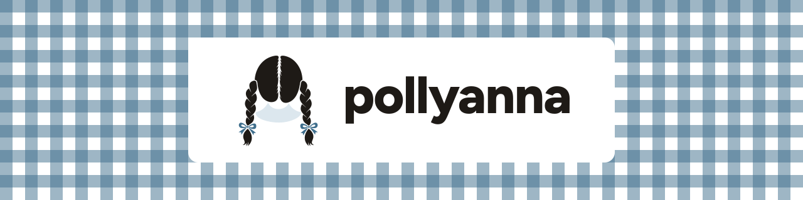
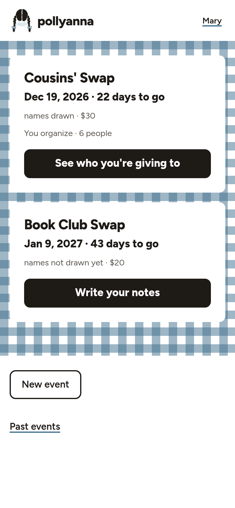
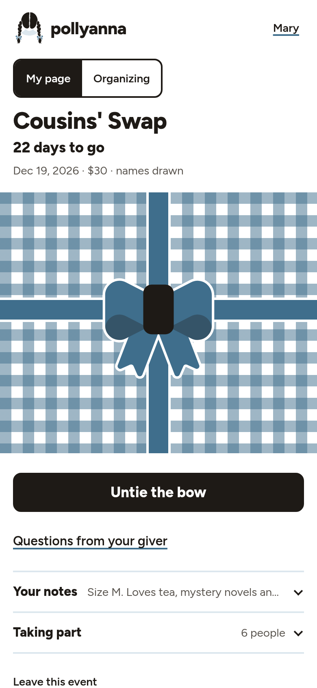
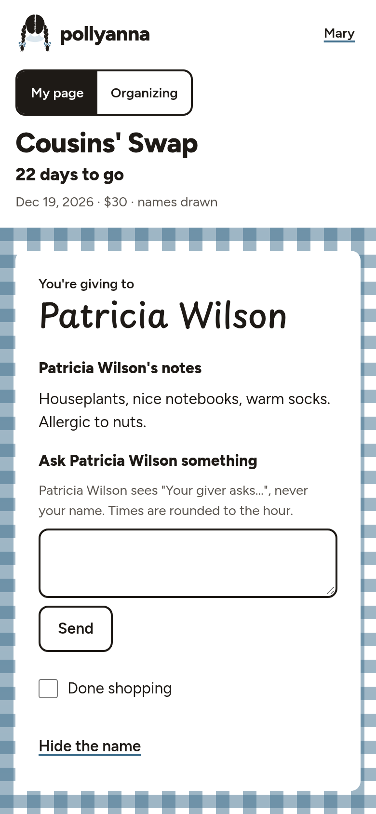
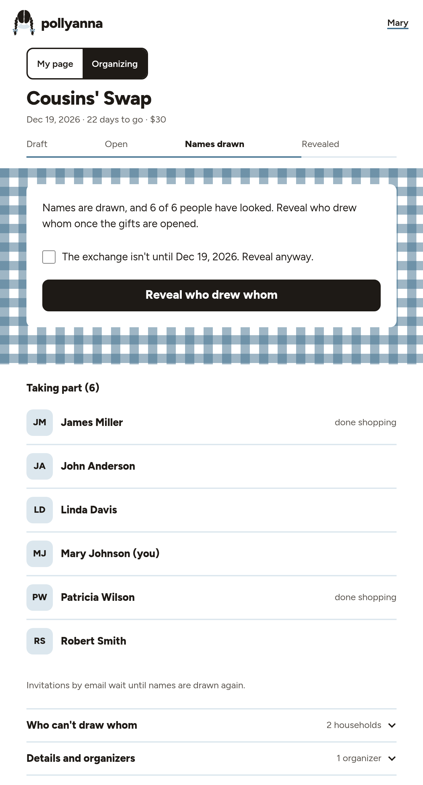
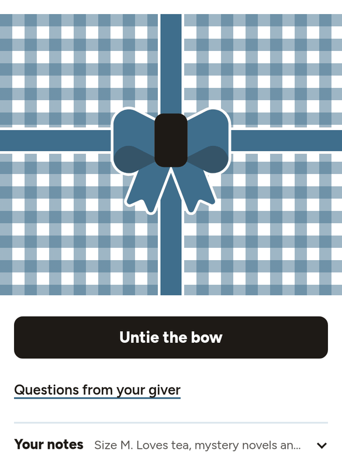
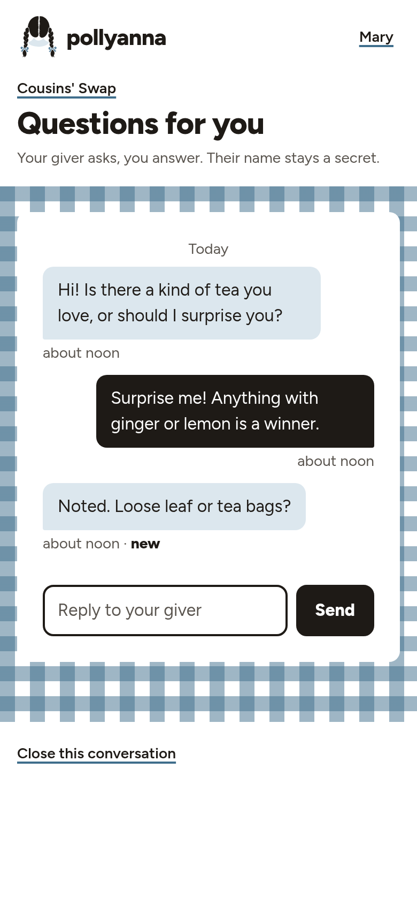

<p align="center">
  
</p>

<p align="center"><em>Names in a hat for your family's gift exchange. Self-hosted, and sealed even from you.</em></p>

<p align="center">
  <a href="https://github.com/MacheteBang/pollyanna/actions/workflows/ci.yml"></a>
  <a href="https://github.com/MacheteBang/pollyanna/releases/latest"></a>
  <a href="LICENSE"></a>
</p>

<p align="center">
  <a href="#quick-start"><strong>Install</strong></a> ·
  <a href="DEPLOYMENT.md"><strong>Docs</strong></a> ·
  <a href="CONTRIBUTING.md"><strong>Contributing</strong></a>
</p>

> **Status:** pre-1.0 (0.0.x) and in active use. Settings may still change between minor
> versions.

<p align="center">
  
  &nbsp;
  
  &nbsp;
  
</p>

## What it is

Pollyanna is a small web app for a family gift exchange: everyone's name goes in the hat,
and each person draws someone to get a gift for. Each person sees only who they're giving to, and
the draw stays sealed from whoever runs the server as well: no screen or log shows who
drew whom, and the database alone can't tell, until the organizer reveals it. It suits
any occasion, from the holidays to a birthday swap or a book club. "A Pollyanna" is what a
gift exchange is called around Philadelphia.

## Features

- **Sealed draw.** The database alone can't tell who drew whom, not even for the person
  running the server ([SPEC §5.2](SPEC.md#52-sealed-storage)).
- **No-repeat rule.** Link this year's event to last year's, and nobody draws the same
  person again.
- **Households and exclusions.** Keep partners or housemates from drawing each other
  ([SPEC §5.1](SPEC.md#51-algorithm)).
- **Anonymous question box.** A giver asks their recipient questions without giving
  themselves away.
- **Reveal day.** Everyone sees who drew whom. Events are then archived, so the history
  stays across years.
- **Your own sign-in.** People sign in through your OpenID Connect provider, and organizers
  invite them by email address. Optionally, add more providers such as Google next to it,
  each one either trusted or open to invited addresses only.
- **Optional email notifications,** which never include who drew whom.
- **Small and private.** Any occasion. Works on phones. No trackers, CDNs or outside assets:
  one small container with SQLite.

## See it

<table>
  <tr>
    <td colspan="2" align="center"></td>
  </tr>
  <tr>
    <td colspan="2"><strong>Organizing.</strong> One next step at a time: add people, set households, draw names, reveal. Organizers see who has looked and who is done shopping, never the pairings.</td>
  </tr>
  <tr>
    <td width="50%" align="center"></td>
    <td width="50%" align="center"></td>
  </tr>
  <tr>
    <td><strong>The reveal.</strong> Untie the bow, and the cloth parts to show who you're giving to.</td>
    <td><strong>The question box.</strong> Your giver asks, you answer, and their name stays a secret.</td>
  </tr>
</table>

There's no hosted demo, because signing in needs a real identity provider. To click
around, [try it locally](CONTRIBUTING.md#try-it-locally) with the mock provider.

## What you need

Pollyanna has no accounts of its own: everyone signs in through an identity provider.
External providers such as Google are optional, and Pollyanna relies only on the services
you choose to configure. Before you start, have:

- **Docker** with the Compose plugin, on a Linux x86-64 host.
- **A reverse proxy that terminates TLS** (Caddy, nginx, Traefik, …).
- **An OpenID Connect provider** where you can register a client, such as Pocket ID,
  Authelia, Authentik or Keycloak. Everyone who takes part needs an account there, or at
  another provider you add next to it
  ([several providers](DEPLOYMENT.md#more-than-one-provider)). If you don't run one yet,
  [Pocket ID](https://pocket-id.org) is the easiest place to start.

## Quick start

1. Register an OIDC client at your provider. The redirect URI is
   `https://<your-host>/auth/callback` ([details](DEPLOYMENT.md#1-register-pollyanna-with-your-provider)).
2. Download the example Compose file and settings:

   ```sh
   curl -fsSLO https://raw.githubusercontent.com/MacheteBang/pollyanna/main/deploy/compose.yaml
   curl -fsSL https://raw.githubusercontent.com/MacheteBang/pollyanna/main/deploy/.env.example -o .env
   chmod 600 .env
   ```

3. Fill in the four settings in `.env`: your public URL, the provider's issuer URL, and
   the client ID and secret ([settings](DEPLOYMENT.md#3-settings)).
4. Create the data and draw-key directories, owned by uid 1654 (the container's user):

   ```sh
   sudo install -d -o 1654 -g 1654 -m 700 data draw-key
   ```

5. Start it: `docker compose up -d`, then `docker compose logs -f` until it says it's ready.
6. Point your reverse proxy at port 8080 ([examples](DEPLOYMENT.md#4-the-reverse-proxy)).

> [!WARNING]
> **Back up the draw key now.** If `draw-key/draw.key` is lost, every assignment that's drawn
> but not yet revealed becomes unreadable, and the only fix is a redraw. Keep the copy apart from
> your data backups ([DEPLOYMENT.md §6](DEPLOYMENT.md#6-the-draw-key-read-this)).

Then run through the [end-to-end check](DEPLOYMENT.md#8-check-it-end-to-end-before-first-use)
before the family signs in.

## Upgrading and backups

To upgrade, set the new version in `POLLYANNA_IMAGE` in `.env`, then run
`docker compose pull && docker compose up -d`. Migrations apply on start, and there's no
downgrade, so take a data backup first ([§7](DEPLOYMENT.md#7-upgrading)).

Back up two things, separately: the data directory, regularly, with the built-in `backup`
command ([§5](DEPLOYMENT.md#5-backups)), and the draw key, once
([§6](DEPLOYMENT.md#6-the-draw-key-read-this)). Keeping them apart is what keeps the draw
sealed from your backups.

## Contributing

Small fixes and improvements are welcome. For anything larger, please open an issue first.
Pollyanna is deliberately small, so pull requests for something
[SPEC.md](SPEC.md) §1 lists as a non-goal may be declined. [CONTRIBUTING.md](CONTRIBUTING.md)
covers running it locally, the tests and how the project is built.

## License

Pollyanna is licensed under the [GNU Affero General Public License v3.0](LICENSE). The fonts,
Figtree and Playpen Sans, are under the SIL Open Font License, and the bow is adapted
from Microsoft Fluent Emoji (MIT); see [THIRD-PARTY-NOTICES.md](THIRD-PARTY-NOTICES.md).
