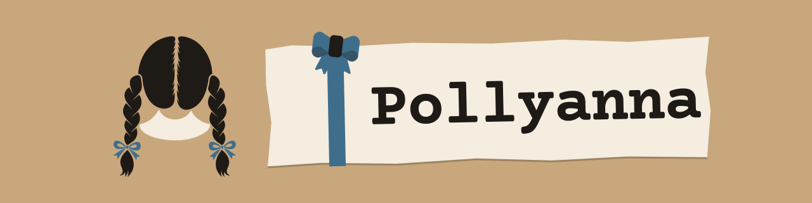
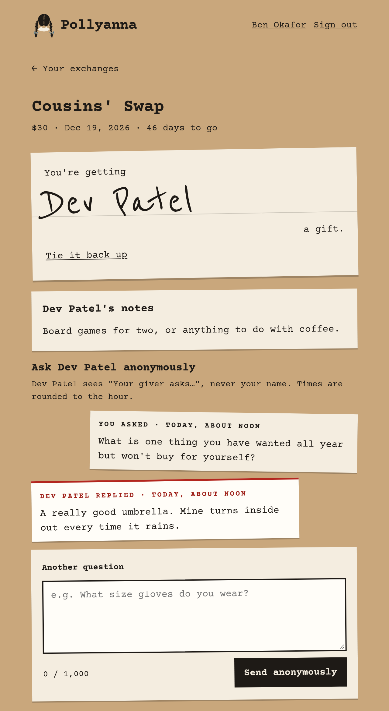
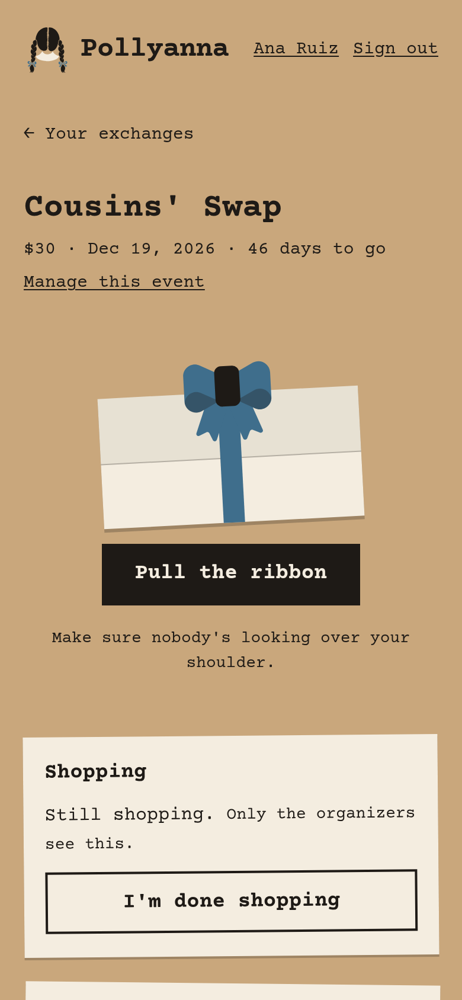
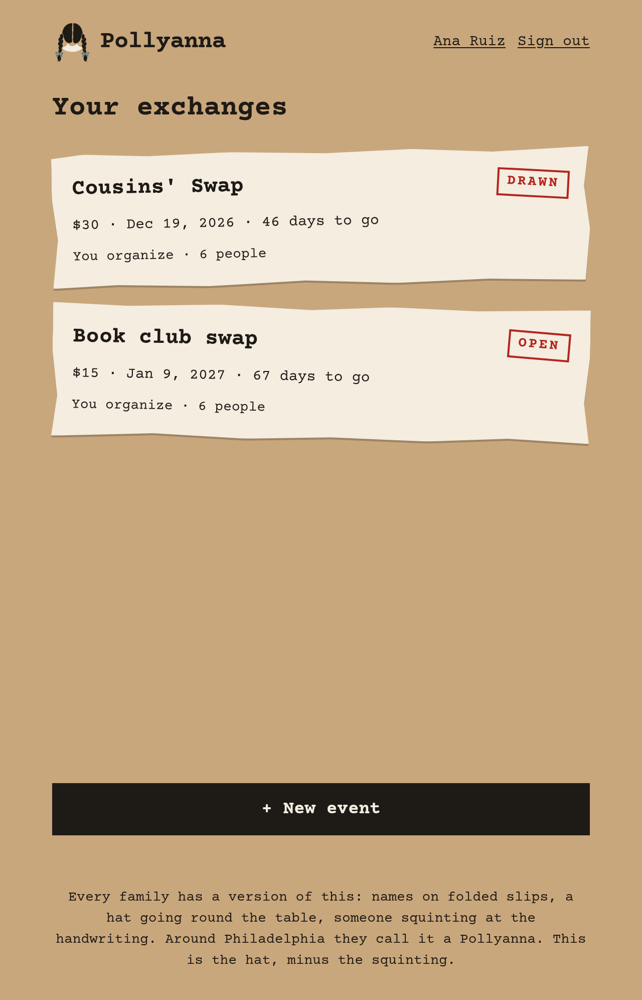
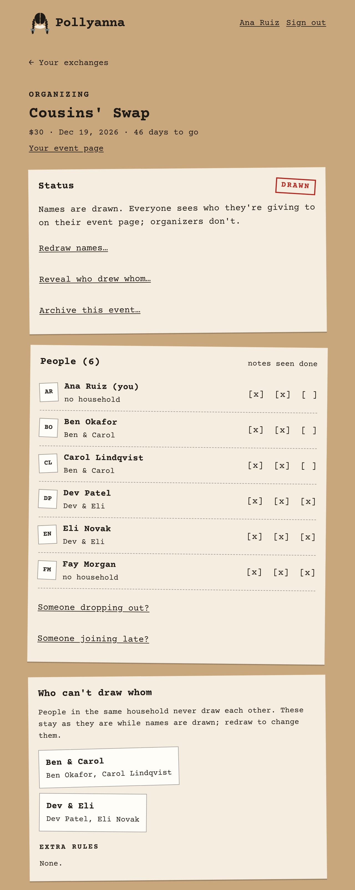
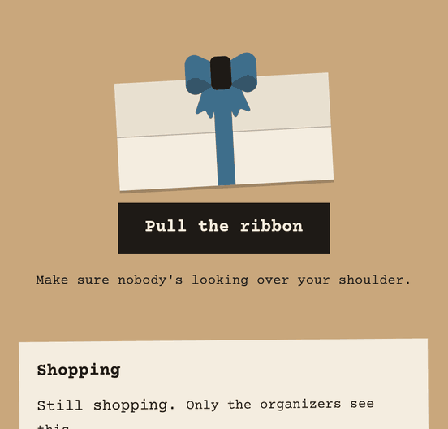
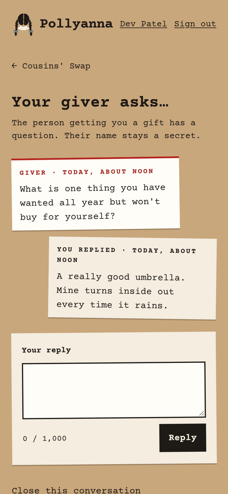

<p align="center">
  
</p>

<p align="center"><em>Names in a hat for your family's gift exchange. Self-hosted, and sealed even from you.</em></p>

<p align="center">
  <a href="https://github.com/MacheteBang/pollyanna/actions/workflows/ci.yml"></a>
  <a href="https://github.com/MacheteBang/pollyanna/releases/latest"></a>
  <a href="LICENSE"></a>
</p>

<p align="center">
  <a href="#quick-start"><strong>Install</strong></a> ·
  <a href="DEPLOYMENT.md"><strong>Docs</strong></a> ·
  <a href="CONTRIBUTING.md"><strong>Contributing</strong></a>
</p>

> **Status:** pre-1.0 (0.0.x) and in active use. Settings may still change between minor
> versions.

<p align="center">
  
  &nbsp;
  
</p>

## What it is

Pollyanna is a small web app for a family gift exchange: everyone's name goes in the hat,
and each person draws someone to get a gift for. Each person sees only their own slip, and
the draw stays sealed from whoever runs the server as well: no screen or log shows who
drew whom, and the database alone can't tell, until the organizer reveals it. It suits
any occasion, from the holidays to a birthday swap or a book club. "A Pollyanna" is what a
gift exchange is called around Philadelphia.

## Features

- **Sealed draw.** The database alone can't tell who drew whom, not even for the person
  running the server ([SPEC §5.2](SPEC.md#52-sealed-storage)).
- **No-repeat rule.** Link this year's event to last year's, and nobody draws the same
  person again.
- **Households and exclusions.** Keep partners or housemates from drawing each other
  ([SPEC §5.1](SPEC.md#51-algorithm)).
- **Anonymous question box.** A giver asks their recipient questions without giving
  themselves away.
- **Reveal day.** Everyone sees who drew whom. Events are then archived, so the history
  stays across years.
- **Your own sign-in.** People sign in through your OpenID Connect provider, and organizers
  invite them by email address.
- **Optional email notifications,** which never include who drew whom.
- **Small and private.** Any occasion. Works on phones. No trackers, CDNs or outside assets:
  one small container with SQLite.

## See it

<table>
  <tr>
    <td width="50%"></td>
    <td width="50%"></td>
  </tr>
  <tr>
    <td><strong>Home.</strong> Every exchange you're in, organizing or taking part.</td>
    <td><strong>Manage.</strong> Organizers add people, set households and draw names, but never see the pairings.</td>
  </tr>
  <tr>
    <td align="center"></td>
    <td align="center"></td>
  </tr>
  <tr>
    <td><strong>The reveal.</strong> Pull the ribbon, the bow unties, and the slip unfolds.</td>
    <td><strong>The question box.</strong> The recipient answers "Your giver asks…" without knowing who's asking.</td>
  </tr>
</table>

There's no hosted demo, because signing in needs a real identity provider. To click
around, [try it locally](CONTRIBUTING.md#try-it-locally) with the mock provider.

## What you need

Pollyanna has no accounts of its own: everyone signs in through an identity provider you
run. Before you start, have:

- **Docker** with the Compose plugin, on a Linux x86-64 host.
- **A reverse proxy that terminates TLS** (Caddy, nginx, Traefik, …).
- **An OpenID Connect provider** where you can register a client, such as Pocket ID,
  Authelia, Authentik or Keycloak. Everyone who takes part needs an account there. If you
  don't run one yet, [Pocket ID](https://pocket-id.org) is the easiest place to start.

## Quick start

1. Register an OIDC client at your provider. The redirect URI is
   `https://<your-host>/auth/callback` ([details](DEPLOYMENT.md#1-register-pollyanna-with-your-provider)).
2. Download the example Compose file and settings:

   ```sh
   curl -fsSLO https://raw.githubusercontent.com/MacheteBang/pollyanna/main/deploy/compose.yaml
   curl -fsSL https://raw.githubusercontent.com/MacheteBang/pollyanna/main/deploy/.env.example -o .env
   chmod 600 .env
   ```

3. Fill in the four settings in `.env`: your public URL, the provider's issuer URL, and
   the client ID and secret ([settings](DEPLOYMENT.md#3-settings)).
4. Create the data and draw-key directories, owned by uid 1654 (the container's user):

   ```sh
   sudo install -d -o 1654 -g 1654 -m 700 data draw-key
   ```

5. Start it: `docker compose up -d`, then `docker compose logs -f` until it says it's ready.
6. Point your reverse proxy at port 8080 ([examples](DEPLOYMENT.md#4-the-reverse-proxy)).

> [!WARNING]
> **Back up the draw key now.** If `draw-key/draw.key` is lost, every slip that's drawn but
> not yet revealed becomes unreadable, and the only fix is a redraw. Keep the copy apart from
> your data backups ([DEPLOYMENT.md §6](DEPLOYMENT.md#6-the-draw-key-read-this)).

Then run through the [end-to-end check](DEPLOYMENT.md#8-check-it-end-to-end-before-first-use)
before the family signs in.

## Upgrading and backups

To upgrade, set the new version in `POLLYANNA_IMAGE` in `.env`, then run
`docker compose pull && docker compose up -d`. Migrations apply on start, and there's no
downgrade, so take a data backup first ([§7](DEPLOYMENT.md#7-upgrading)).

Back up two things, separately: the data directory, regularly, with the built-in `backup`
command ([§5](DEPLOYMENT.md#5-backups)), and the draw key, once
([§6](DEPLOYMENT.md#6-the-draw-key-read-this)). Keeping them apart is what keeps the draw
sealed from your backups.

## Why Pollyanna?

There are good self-hosted gift apps already. Pollyanna exists for one thing they don't do:
a draw that stays sealed from the person running it, and that remembers last year's.

- [GiftManager](https://github.com/icbestCA/giftmanager) comes closest, with a draw,
  exclusions and generic OIDC. It stores pairings in plaintext, though, and has no
  no-repeat rule.
- [Wishlist](https://github.com/cmintey/wishlist) and
  [Christmas Community](https://github.com/Wingysam/Christmas-Community) have good OIDC
  support and are made for sharing wishlists, but they don't draw names. They work well
  alongside Pollyanna, which deliberately has no wishlists.

## Contributing

Small fixes and improvements are welcome. For anything larger, please open an issue first.
Pollyanna is deliberately small, so pull requests for something
[SPEC.md](SPEC.md) §1 lists as a non-goal may be declined. [CONTRIBUTING.md](CONTRIBUTING.md)
covers running it locally, the tests and how the project is built.

## License

Pollyanna is licensed under the [GNU Affero General Public License v3.0](LICENSE). The fonts,
Courier Prime and Reenie Beanie, are under the SIL Open Font License, and the bow is adapted
from Microsoft Fluent Emoji (MIT); see [THIRD-PARTY-NOTICES.md](THIRD-PARTY-NOTICES.md).
